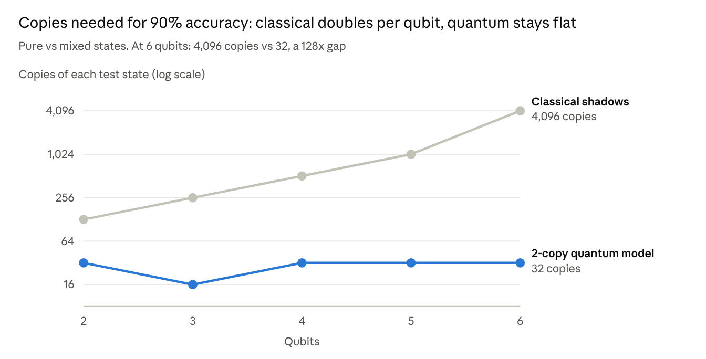
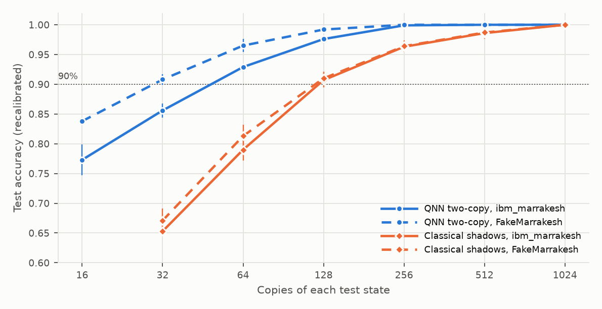

# Honest Quantum Machine Learning on Real IBM Hardware

Vivek Reddy · November 9, 2026

In our experiments, the quantum models we tested beat the classical baselines we tested only when the data was itself quantum. Over two projects we trained small quantum neural networks, ran them on IBM's 156-qubit `ibm_marrakesh`, and held every result against a fair classical baseline.

Three findings stand out:

- **On ordinary data, quantum did not win.** A 4-qubit classifier for movie-review sentiment and CVE severity came within about 2 points of tuned classical models given the same inputs, and was not ahead of any of them, on fresh data we held back until the very end.
- **Real hardware stayed close to ideal for these small circuits.** On 200 inputs per task, `ibm_marrakesh` showed no significant accuracy change against the noise-free simulator on the same inputs, but its average output was nudged slightly in one direction in every run, a small bias whose size varied from run to run.
- **On quantum data, a two-copy model needed far fewer copies.** In simulation, telling pure from mixed states took the tested two-copy model 16 to 32 copies on average (16 to 64 for individual training seeds) at every size from 2 to 6 qubits; the classical method we tested needed 128 at 2 qubits and up to 4,096 at 6. In a preliminary run on the real device at 2 qubits it stayed ahead; by point estimate the ratio was smaller (about 2.5 to 3×, against 6× in a noise-free simulation of the same states), but the uncertainty is too broad to call that a real reduction. That illustrates a known theoretical result rather than a new one.

## Why honest benchmarking matters

A quantum accuracy number means little on its own. "Our quantum model scored 80%" says nothing if a classical model on the same inputs scores 85%. Demos often leave that comparison out. We held ourselves to four rules:

1. **Same inputs.** Classical baselines see exactly the features the quantum circuit sees, so the comparison isolates the model.
2. **A strong classical reference.** We also report a classical model trained on all the data with the full embedding, so a quantum win can't come from a weak baseline.
3. **Same samples on hardware.** Real-device runs use a subset of the test set to save quantum time, so we compare them only with the noise-free simulator on those exact samples.
4. **Repeat before concluding.** A surprising hardware number gets rerun, and checked against the variation expected from finite sampling (shot noise).

Rule 3 mattered in practice. Our first hardware chart put a 40-sample hardware score beside 200-sample simulator scores. It made the device look better than the simulator on one dataset, purely because the question sets differed.

## Project 1: a quantum text classifier

The first project asks the obvious question: can a small quantum circuit classify everyday text? The answer: about as well as a classical model handed the same 4 numbers, and no better.

The pipeline is hybrid. A sentence-embedding model turns each text into 384 numbers. Partial least squares (PLS) squeezes those to the 4 directions that best predict the label. A 4-qubit circuit makes the final call. We tested two tasks: movie-review sentiment (Rotten Tomatoes, 10,662 sentences), and CVE severity, predicting from a vulnerability's description whether it is rated high/critical (12,116 NVD entries from early 2024, tested on CVEs published after the training ones).

| Model (mean over 3 training seeds) | Sentiment (1,066 test sentences) | CVE severity (2,424 test CVEs) |
| --- | --- | --- |
| Always guess the common class | 0.500 | 0.578 |
| Quantum, 4 qubits | 0.757 | 0.699 |
| Classical, same 4 numbers, tuned | 0.772 | 0.691 |
| Classical, full embedding | 0.774 | 0.715 |

**Then we checked on data we had never looked at.** Those test-set numbers are the ones we watched while designing the circuit, so they may flatter it: on them the quantum model looked 1.5 points behind on sentiment and slightly ahead on CVE. So we froze everything, published our predictions and the exact analysis in the repository, and only then downloaded fresh data: Rotten Tomatoes' unused validation sentences, and 13,432 newer CVEs from May to August 2024. On that data the quantum model scored 0.766 against 0.769 for tuned logistic regression on sentiment, so the 1.5-point gap we expected did not show up. On CVE it scored 0.708 against 0.720, within the ±3-point margin we had set for a tie, but it was now slightly behind rather than ahead, and a tuned SVM beat it by 1.8 points. Either way, the quantum model never had the higher score (by point estimate; it was clearly worse only against the tuned SVM on CVE). Three training runs are a thin basis for the run-to-run part of those error bars, so afterwards we trained seven more, again writing the plan down before running. Because the original plan named three runs, we treat this as a check rather than the main result. With ten runs both conclusions held and the error bars narrowed: on sentiment the two models were level (0.766 vs 0.765); on CVE the quantum model (0.711 vs 0.720) stayed within the tie margin but was now clearly, if slightly, behind.

**One design choice mattered far more than the rest.** Our first circuit used the textbook `ZZFeatureMap` encoding and barely beat a coin flip on our benchmark. A controlled test over three seeds pinned it down: swapping in that encoding cost 19 to 24 points on breast cancer, whether or not the input was re-uploaded (0.91 vs 0.67 with re-uploading, 0.89 vs 0.70 without).

- re-uploading the input before each layer: about 2 points with our encoding, and slightly negative with `ZZFeatureMap`
- reading one qubit instead of all of them: about 1 point, in the other direction
- the optimizer, and training on exact vs sampled probabilities: about 1 point each
- 2, 4 or 6 qubits: within about 1 point

In this experiment the encoding change was by far the largest. On the classical side, supervised PLS beat unsupervised PCA by about 15 points on text, because it keeps the label-relevant directions.

**Can a classical model do what the circuit does?** Yes. Because the circuit feeds each input in twice through a simple rotation, whatever it outputs is mathematically a fixed kind of function: a sum of sines and cosines with 312 possible frequency combinations. We checked this directly: fitting that sum to our trained circuit reproduced it to 15 decimal places. Then we skipped the quantum circuit entirely and trained an ordinary classical model on those sine and cosine features, with a plan written down before running it. On the fresh CVE data it scored 0.727, beating the quantum model's 0.708. On fresh sentiment data it scored 0.756 against 0.766, too close to call, and plain logistic regression on the 4 numbers (0.769) beat both. So a classical model can represent anything this circuit computes; how well it trains depends on the task: better on CVE, too close to call on sentiment. Ten training runs gave the same picture: 0.727 vs 0.711 on CVE, and 0.753 vs 0.766 on sentiment, still too close to call.

## On real hardware: closer to ideal than expected

We ran the trained sentiment and CVE classifiers on `ibm_marrakesh` through IBM's free Open Plan: 200 test inputs per task, 1,024 shots per input, no error mitigation, and the same four physical qubits in every run. We compared each run with the noise-free simulator on the same inputs, and with two simulated noise models.

| Task | Noise-free | ibm_marrakesh, per run | Bias in P(class 1) [95% CI] |
| --- | --- | --- | --- |
| CVE severity | 0.685 | 0.685, 0.655, 0.700 | −0.005 [−0.007, −0.003] |
| Sentiment | 0.740 | 0.730 | −0.004 [−0.006, −0.001] |

**Accuracy: no significant change.** We ran CVE three times, the last one three hours after the first two, and sentiment once. In no run did accuracy differ significantly from the noise-free simulator on the same inputs (an exact paired test, McNemar's, gave p = 1, 0.07 and 0.45 for CVE and 0.63 for sentiment). With 200 inputs that only rules out large changes. The number of predictions that flipped was at the edge of what 1,024-shot sampling alone predicts: 19 against 13.3 expected over the three CVE runs (p = 0.055), and 4 against 3.1 for sentiment (p = 0.37). Repeated runs agreed on 96% of predictions. The compiled circuit is small: depth 37, six two-qubit gates.

**Bias: small, consistent in sign, varying in size.** In every run the device nudged the average output toward "negative" and "low/medium". Per CVE run the shift was 0.006 and 0.005, then 0.002 three hours later, and that last one is within error of zero, even though IBM reported the same calibration for those qubits. Pooled over the three runs it is 0.005, with an interval that excludes zero. That is too small to change accuracy measurably, though it can tip individual inputs that sit near the 0.5 line, which is why an earlier 40-input run happened to lose 3 CVE answers.

**Match the noise model to the device.** Qiskit's simulated copy of the same machine (`FakeMarrakesh`) reproduced both the accuracy and the bias on that device. A simulated copy of an older 5-qubit device (`FakeManilaV2`) overstated the bias about fivefold and changed significantly more predictions than chance allows.

**Two more IBM computers.** IBM's free plan also offers `ibm_kingston` and `ibm_fez`, the same 156-qubit Heron model. With the quantum time we had left, we ran the CVE classifier once on each, on 100 of the same inputs.

| Device, same 100 inputs (noise-free 0.650) | Accuracy | Average shift |
| --- | --- | --- |
| ibm_marrakesh (3 runs) | 0.650, 0.600, 0.660 | −0.005 |
| ibm_kingston (1 run) | 0.630 | −0.009 |
| ibm_fez (1 run) | 0.640 | −0.015 |

Again no device changed accuracy significantly, and every one nudged outputs the same way. But the size differed: in the Fez run it was about three times Marrakesh's, a clear difference for these runs. Qiskit's simulated Fez understated the bias in that run, while the simulated Marrakesh matched the real one. With one run per new device, we can't tell a property of the device from a bad hour.

## Project 2: quantum-native data

If quantum models have an edge, theory says it is on data that is quantum to begin with. The second project, Entangle, classifies quantum states directly, comparing a quantum model with classical methods that only see measurement results.

**Entanglement (2 to 4 qubits).** A quantum model that receives two copies of each state at once (a "2-copy" model) told entangled from unentangled states perfectly in exact simulation, and 0.99 to 1.00 with 256 copies, over five seeds. The same circuit with one copy stayed at chance, about 0.50. That is expected for this model: with one copy, its output probability is a linear function of the state, and this entanglement label is not; it does not mean every single-copy method fails. Classical models given the raw state vectors also struggled: 0.72, 0.57 and 0.52 at 2, 3 and 4 qubits. But classical models given 256 random-measurement snapshots ("classical shadows") reached 0.95, 0.98 and 0.99, within 0.04 to 0.01 of the quantum model. So this task does not separate the two.

**Phases of matter.** Classifying ground states of the Ising spin chain (4 to 8 qubits) gave no quantum edge: every model, quantum or classical, scored 0.96 to 1.00. A toy lattice gauge theory gave the same picture. The task turned out to be easy: a logistic regression on a single number, such as the average magnetisation, scores 0.99 or better. Every model's mistakes sit near the phase transition, about a fifth of the test states. The tutorial version of the quantum convolutional network (QCNN) also output a constant 0.5 on these symmetric states, so we replaced its building blocks.

**Pure or mixed: a gap that grows quickly with size.** Here theory predicts that single-copy strategies need exponentially many copies as the system grows, while a 2-copy test needs a fixed number. In our simulated test, the learned 2-copy model reached 90% accuracy with 16 to 32 copies on average (16 to 64 for individual training seeds) at every size, while the classical-shadow method we tested needed 128 copies at 2 qubits and up to 4,096 at 6:

One caveat: this confirms a known theoretical separation (multi-copy quantum learning) at small scale rather than discovering a new one. The 2-copy model also needed care to train. With separate weights for each copy pair, one of three training runs failed at 5 qubits. We then measured why: at random starting points the gradients shrink about 4× per added qubit, the "barren plateau" effect. Sharing one block of weights across copy pairs slowed that to 1.7× per qubit, and training worked.

**Pure or mixed on the real device (preliminary).** We ran the 2-qubit version on `ibm_marrakesh` as two jobs, on 60 test states with 1,024 copies each. Pure and mixed states were prepared with circuits of the same depth, so the device could not tell them apart by circuit length. Both methods were trained in simulation, then each got the same small correction on the device: a two-number refit on 20 separate, labelled calibration states. That changed accuracy by at most 3 points. With all 1,024 copies, every model scored 0.99 to 1.00. With fewer copies the gap showed. We estimated each threshold by resampling the raw measurements a thousand times, which gives honest (and wide) error bars:

| Copies of each state needed for 90% | Noise-free simulation | ibm_marrakesh, two jobs |
| --- | --- | --- |
| 2-copy quantum model | 16 | 48 and 55 |
| Classical shadows | 108 | 128 and 128 |
| Ratio (95% interval) | 6.3 (2.5 to 14.9) | 2.9 (1.3 to 7.1) and 2.5 (1.1 to 6.3) |

The quantum model stays ahead in both jobs on this one shared set of 60 states, but the error bars overlap the simulated ratio, so we can't say the device shrank the advantage. (The noise-free 6.3 here is measured on these same states; it differs from the 32-vs-128 grid reading in the simulation chart, which used other states.) With two jobs on one set of 60 states, this is an illustration rather than a measurement of how the gap scales. The 2-copy circuit is about three times deeper than a shadow circuit (19 two-qubit gates after compiling, against 7), which plausibly explains why it lost more. Replaying the exact same compiled circuits through Qiskit's simulated copy of the device understated the 2-copy circuit's output shift about twofold, unlike for the shallow text classifier. Entangle's entanglement and phase classifiers also ran on the device (40 states, two jobs). After the same kind of recalibration they stayed at 0.93 to 0.99, but with so few states no ranking between models is statistically meaningful.

## What we learned

In our tests, the quantum models showed an edge in only one setting: quantum data that can be loaded two copies at a time. Everywhere else, a well-built classical model matched them.

| Setting we tested | Quantum edge? | Why |
| --- | --- | --- |
| Everyday data (text, medical, synthetic) | No | A classical encoder does the heavy lifting; the circuit only classifies 4 numbers |
| Quantum data, one copy at a time | No | This model's output is linear in the state; classical shadows do as well |
| Phases of matter, lattice gauge toy | No | Every model scores 0.96 to 1.00, so the task may be too easy to separate models |
| Quantum data, two copies at once (simulated; 2 qubits on hardware) | Yes, for this purity test | 16 to 32 copies (average) vs 128 to 4,096 for the classical-shadow method; about 50 vs 120 in a preliminary hardware run |

Practical lessons for anyone trying this:

- **Choose the encoding before adding qubits.** In our ablation the data encoding moved accuracy by 21 points; going from 2 to 6 qubits moved it by about 1.
- **Test small circuits on real hardware, and look past accuracy.** For these shallow circuits the device matched the noise-free accuracy, but it still carried a small, measurable bias in its outputs.
- **Use a noise model of the same device, and still check it.** A simulated copy of `ibm_marrakesh` predicted the shallow text circuit's behaviour; a model of an older device did not, and the simulated copy of ibm_fez understated the bias in our Fez run. For the deeper 2-copy circuit, even the same-device model understated the noise in our two jobs.
- **Expect tooling friction.** Both projects hit the same bug: `qiskit-ibm-runtime` 0.44.1 claims Qiskit 1.x support but breaks real-device compiling on it. One pinned the package, the other changed a compiler setting. We reported it as [Qiskit/qiskit-ibm-runtime#3563](https://github.com/Qiskit/qiskit-ibm-runtime/issues/3563).
- **Run it on a free plan.** All hardware runs fit within IBM's free Open Plan, a rolling 10 minutes per 28 days.

## Limitations and what's next

These are small experiments, and they should be read that way:

- **Small scale.** At most 8 qubits, simulated exactly, so nothing here is beyond classical computers.
- **Small hardware samples.** On the device, project 1 used 200 test inputs per task, with three CVE runs and one sentiment run on one day, plus one 100-input CVE run on each of two other IBM devices. Entangle's hardware runs used 40 to 60 states and two runs each, and the purity test ran on hardware only at 2 qubits: larger versions need deeper circuits than the device can run cleanly. Enough to measure accuracy and bias, not to rank models within a task.
- **Designed while looking at test scores.** We chose the circuit and features while watching test accuracy. The fresh-data check covers the two text tasks only; the ablation and the quantum-data results have no such untouched replication.
- **A known result.** The purity gap matches the multi-copy separation proven by Huang et al. in ["Quantum advantage in learning from experiments"](https://arxiv.org/abs/2112.00778). We illustrate it at small scale against one classical method; we do not claim a new or general separation.
- **Approximate labels.** Predicting CVE severity from the description alone approximates CVSS, which also scores attack vector, privileges and impact.

Next steps:

- Run the purity test on hardware at 3 or more qubits, which will need error mitigation or a less noisy device.
- Push the hardware study past where noise starts to matter: more qubits, deeper circuits, and a plot of accuracy loss against two-qubit gate count.

Code, data pipelines and every result file live in two repositories: [H3XY/AGI](https://github.com/H3XY/AGI) (project 1) and [H3XY/Entangle](https://github.com/H3XY/Entangle) (project 2). Each reproduces its numbers with one command per experiment.
